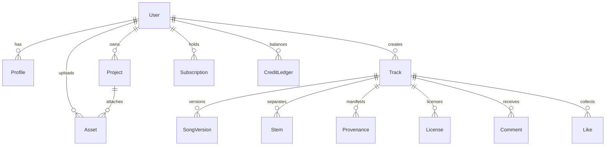

# Fombo Music AI — System Architecture Specification
**Document Version:** 2.0.0-PROD  
**Classification:** Core System Architecture  

---

## 1. System Vision & Architectural Principles

Fombo Music AI is built upon five foundational architectural tenets:
1. **Decoupled Compute Boundary**: Web application rendering and client interactions run strictly on the Next.js App Router edge. GPU inference is completely isolated from the web tier and executed on dedicated, self-hosted worker clusters (RunPod, Modal, EC2 G5).
2. **Zero-Mock Truthfulness**: The API never fakes completion, generates empty audio buffers, or fabricates copyright protections. When an inference worker is unconfigured or offline, the interface explicitly informs the creator: `"Generation engine not configured"`.
3. **Dual-Tier Audio DSP Engine**:
   - Client Tier: Fast, sample-accurate Web Audio API execution for real-time waveform visualizers, multichannel gain/pan, metronome, and offline WAV rendering.
   - Server Tier: Asynchronous FastAPI and Celery background workers for Demucs v4 4-stem separation, FFmpeg audio transcoding, and C2PA cryptographic hashing.
4. **Provider-Agnostic Model Interface**:
   - Future default open-weight provider: **ACE-Step 1.5**.
   - Future alternative provider: **HeartMuLa**.
   - Zero-dependency local procedural fallback for testing without external services.
   - Cloud proxy adapters for Suno API and Stability Audio.
5. **C2PA-Compliant Provenance & Commercial Rights**:
   - SHA-256 audio digests, parent stem lineage, generation timestamp, prompt references, and statutory non-infringement disclaimers embedded into every track certificate.

---

## 2. High-Level Architecture Topology

```
+-----------------------------------------------------------------------------------------------+
|                                    CLIENT BROWSER LAYER                                       |
|                                                                                               |
|  Next.js 14 App Router (React 18, TypeScript, Tailwind CSS, shadcn/ui Design Tokens)          |
|  * Persistent Player Context (AudioContext, GainNode, AnalyserNode, Canvas Visualizer)        |
|  * Multitrack Browser DAW (/studio): Sample-accurate Web Audio timeline, Channel Strips       |
|  * Routes: /, /create, /studio, /library, /explore, /search, /playlists, /publish, etc.       |
+-----------------------------------------------+-----------------------------------------------+
                                                | HTTPS / WSS / SSE
                                                v
+-----------------------------------------------------------------------------------------------+
|                                  FASTAPI API GATEWAY LAYER                                    |
|                                                                                               |
|  * OAuth2 / Supabase Session Verification & RBAC Guards (Free, Pro, Studio, Admin)            |
|  * Redis Token Bucket Rate Limiter (HTTP 429 enforcement)                                     |
|  * Server-Sent Events (SSE) Inference Telemetry Streamer (/jobs/{id}/stream)                  |
|  * S3/R2 Presigned Upload & Download Token Dispenser                                          |
|  * Security Middleware: CORS, CSP, X-Frame-Options, XSS Sanitizer, SSRF Validator              |
+-----------------------+-------------------------------+---------------------------------------+
                        |                               |
        SQLAlchemy 2.0  |                               | Celery Task Broker
        AsyncPool       |                               | (Redis 7 AOF)
                        v                               v
+-----------------------------+     +-----------------------------------------------------------+
|    POSTGRESQL 16 (MANAGED)  |     |               CELERY ASYNC WORKER CLUSTER                 |
|                             |     |                                                           |
|  * Users & Profiles         |     |  * Queue "generation": AI audio synthesis dispatch        |
|  * Projects & Tracks        |     |  * Queue "stems": Demucs v4 4-stem separation             |
|  * Audio Assets & Stems     |     |  * Queue "audio_processing": FFmpeg normalization & peaks |
|  * Subscriptions & Ledgers  |     |  * Queue "cleanup": Periodic stale upload purging         |
|  * Provenance & Audit Logs  |     +-----------------------------+-----------------------------+
+-----------------------------+                                   |
                                                                  | HTTP / gRPC
                                                                  v
+-----------------------------+     +-----------------------------------------------------------+
|    CLOUDFLARE R2 / S3       |     |               DEDICATED GPU WORKER CLUSTER                |
|                             |     |                                                           |
|  * Master WAV / FLAC Audio  |     |  [1] ACE-Step 1.5 Open-Weight Diffusion Transformer       |
|  * Streaming MP3 Audio      |<----+  [2] HeartMuLa Multimodal Music Model                     |
|  * Isolated Stems (/vocals) |     |  [3] Audiocraft MusicGen Medium / Large                   |
|  * Waveform JSON / Binaries |     |  [4] Demucs v4 HTDemucs Hybrid Transformer Worker         |
+-----------------------------+     +-----------------------------------------------------------+
```

---

## 3. Database Schema Entity Relationships



---

## 4. Hardware Sizing & Scaling Guidelines

| Component | Minimum Dev Spec | Production Recommended Spec |
| :--- | :--- | :--- |
| **API Gateway** | 1 vCPU, 512MB RAM | 4 vCPU, 8GB RAM (Autoscaled 2–10 nodes) |
| **Redis Broker** | 256MB RAM | 4GB RAM with AOF persistence |
| **PostgreSQL** | 1GB RAM | Neon / RDS Aurora 8 vCPU, 32GB RAM |
| **CPU Audio Workers** | 2 vCPU, 2GB RAM | 8 vCPU, 16GB RAM with FFmpeg hardware accel |
| **GPU Inference Node** | Local CPU Synth | NVIDIA A10G (24GB VRAM) or A100 (80GB VRAM) |
